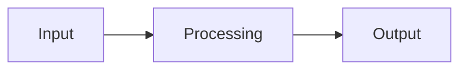

## Problem

TODO: who has the problem, why it matters, what existed before.

## Architecture

TODO: one diagram, then a short walk through it.

## Technical choices & trade-offs

TODO: each choice with the alternative you rejected and why.

## Results

TODO: how it was measured, then the numbers.

| Metric | Value |
| ------ | ----- |
| TODO   | TODO  |

## Limitations & next steps

TODO: what does not work yet and what you would do next.

## Links

- [Source code on GitHub](https://github.com/rmouahid/project-name)
