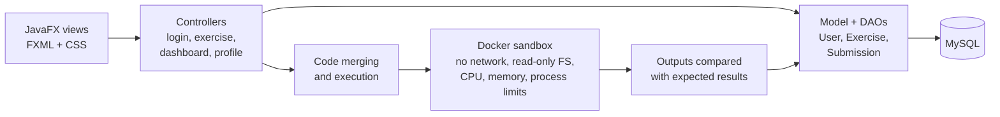

## Problem

A desktop coding-exercise platform inspired by CodinGame: users sign up, pick an exercise and a language, write their
solution in an editor, and get it compiled, run and checked against expected outputs. Scores and submission statistics
are tracked per user.

School project at CY Tech (group G18). TODO: your own part in the group.

## Architecture

- Exercises in five languages: Python, Java, C, JavaScript and PHP. Toolchains live in the sandbox image, not on the
  host.
- "Include" exercises: the user writes a function that is merged into base code and run against generated tests.
- Dashboard with score and submission history.

## Technical choices & trade-offs

- **Every submission runs in a throw-away Docker container** with no network, a read-only filesystem and CPU, memory and
  process limits. Without Docker the app refuses to run submissions rather than running untrusted code on the host.
- **Passwords hashed with salted PBKDF2.**
- **No hard-coded credentials**: database settings come from a git-ignored file, environment variables or JVM
  properties.
- **DAO tests against H2 in MySQL mode**, so the suite runs without a MySQL server; sandbox integration tests run real
  programs when the image is present.
- TODO: the alternatives you considered and why you rejected them.

## Results

TODO: measured results (for example submissions run, sandbox overhead, test count and coverage).

| Metric | Value |
| ------ | ----- |
| TODO   | TODO  |

## Limitations & next steps

TODO: known limitations and next steps.

## Links

- [Source code on GitHub](https://github.com/rmouahid/CodYngame)
- [Sandbox design](https://github.com/rmouahid/CodYngame/blob/main/sandbox/README.md)
- [Specification and project report](https://github.com/rmouahid/CodYngame/tree/main/doc)
