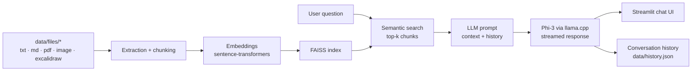

## Problem

Documentation is spread across text, Markdown, PDF, image and Excalidraw files. doc-centralizer lets a user explore and
understand it through natural-language conversations, locally, with answers grounded in the files.

TODO: who needed it and in what context.

## Architecture

- Documents are extracted, chunked and embedded on first run; the FAISS index is built once and cached.
- The cache (embeddings, index, chunk metadata) is invalidated and rebuilt whenever a file is added, removed or
  modified.
- Several conversations can be kept, switched and deleted; their history is persisted and given to the model.

## Technical choices & trade-offs

- **Fully local generation**: quantized Phi-3 mini 128k (`Q4_K_M`, about 2.4 GB) through llama.cpp, with an optional
  NVIDIA GPU for faster inference.
- **FAISS for semantic search** over sentence-transformers embeddings.
- **Model weights outside the Docker image**: `models/` and `data/` are mounted as volumes instead of copying
  multi-gigabyte weights into the image.
- **Tests without the model**: chunking, embedding/FAISS and history logic are tested in CI without the LLM file.
- TODO: the alternatives you considered for each choice and why you rejected them.

## Results

TODO: measured results (retrieval quality, answer latency, memory use).

| Metric | Value |
| ------ | ----- |
| TODO   | TODO  |

## Limitations & next steps

TODO: known limitations and next steps.

## Links

- [Source code on GitHub](https://github.com/rmouahid/doc-centralizer)
