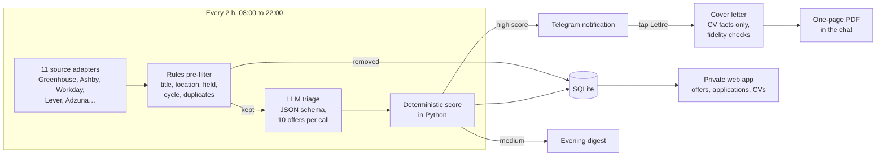
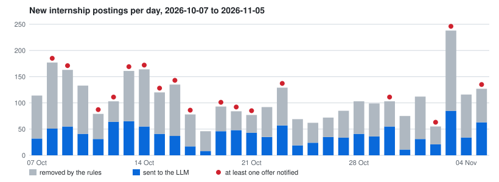

## Problem

AI internships appear first on company career pages (Greenhouse, Ashby, Workday…) and only later, often without a
description, on job boards. Checking 119 companies by hand every day is not realistic, and most new postings are out of
scope: wrong country, wrong field, past cycle, or a copy of a posting already seen.

intern-radar finds those postings as soon as they are published, triages them against a candidate profile, and sends
only the good ones to Telegram with a one-tap tailored cover letter.

## Architecture

1. **Collect**: one adapter per job-board API, internship titles only, at least 1 s between two requests to the same
   host. A broken posting or source never stops the run, and a source failing for 3 days raises an alert.
2. **Pre-filter**: pure rules remove what an LLM call would waste money on (France-only, out-of-scope fields, past
   cycles, aggregator copies).
3. **Triage**: an LLM returns internship status, AI relevance, fit with the internship window, eligibility and visa
   notes, validated against a JSON schema.
4. **Score**: `0.5 × company tier + 0.3 × AI relevance + 0.2 × dates`, computed in Python with hard exclusions, so it is
   reproducible and tested.
5. **Act**: a notification with _Voir l'offre_ and _Lettre de motivation_ buttons; the letter is drafted from the CV
   only, checked for invented facts, and returned as a PDF.

## Technical choices & trade-offs

- **Rules before the LLM.** Two thirds of the postings are rejected for free by regular expressions and location rules;
  the LLM only sees what rules cannot decide.
- **The LLM judges, Python scores.** The model returns structured facts (dates fit, eligibility, AI relevance), never
  the final score. The weighting is a pure function with unit tests, so changing a weight is a `rescore`, not a new
  round of prompts.
- **Company career APIs, not job boards.** Greenhouse, Ashby or Workday publish postings first and in full; aggregators
  (Adzuna, Simplify) only fill the gaps, and their copies of an ATS posting are dropped.
- **SQLite, systemd and the standard library.** One file, one 1 vCPU / 2 GB VPS, no framework for the web app: the whole
  system fits a student budget and runs unattended.
- **Telegram as the interface.** No inbound port on the server (long polling), notifications on the phone, and the
  letter arrives where the offer was read.

## Results

Production database, 2026-10-07 to 2026-11-05 (30 days):

| Metric                                     |         Value |
| ------------------------------------------ | ------------: |
| New internship postings per day (median)   |           103 |
| Removed by the rules before any LLM call   | 63 % of 3,264 |
| LLM tokens per day (median, every purpose) |       113,956 |
| LLM cost per day (median, API-equivalent)  |         $0.15 |
| Run duration p50 / p95                     |  69 s / 5 min |
| Detection to Telegram notification p50     |         3 min |

Coverage: 119 companies, 85 of them with a public feed read by one of the 11 adapters.

Generated by `intern-radar metrics` from the production database.

## Limitations & next steps

- 34 watched companies (Google, Meta, Apple, Mistral…) publish no usable feed and are only seen through aggregators,
  with a delay and often without a description.
- The LLM triage is a filter, not a verdict: scoring the same offers twice does not always give the same categorical
  answers, and many postings do not state their dates. **Its precision and recall have not been measured against hand
  labels.**
- Single user, single Telegram chat; letters are generated one at a time.
- The triage uses the `claude` CLI and its subscription quota, shared with interactive use.
- TODO: next steps you plan (for example a hand-labelled set to measure triage precision and recall).

## Links

- [Source code on GitHub](https://github.com/rmouahid/intern-radar)
- [Architecture and design decisions](https://github.com/rmouahid/intern-radar/blob/develop/docs/architecture.md)
- [Pipeline reference, failure modes and limits](https://github.com/rmouahid/intern-radar/blob/develop/docs/pipeline.md)
- [Full operating metrics](https://github.com/rmouahid/intern-radar/blob/develop/docs/metrics.md)
