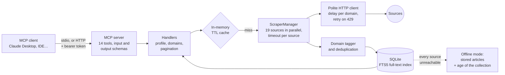

## Problem

An LLM assistant does not know today's news: its knowledge stops at its training cutoff. NovIT is an MCP server that
gives Claude, and any MCP client, the day's tech news. It collects 19 sources (news, AI, security, engineering,
regulation, learning), ranks them for the user's profile and returns answers that can be cited, as Markdown and as
structured data.

## Architecture

- **14 MCP tools**: news by profile and by domain, daily digest, full-text search, trends, related articles, reading an
  article, preferences, user feedback and server health. Every tool declares its input schema and annotations (read-only
  or not); the three article tools also declare an output schema and return articles as `structuredContent`.
- **Two profiles**: student (teaching tone) and engineer (technical and concise), which change the priority sources, the
  domains and the tone.
- **Polite to the sources**: every request goes through a client that enforces a minimum delay per domain (6 s for NVD
  without a key, 3 s for arXiv), retries after a 429 while respecting `Retry-After`, and identifies itself with a user
  agent.
- **Fault tolerant**: a failing source does not stop the collection; if all of them fail, NovIT serves the stored
  articles with the date of the last successful collection and retries in the background.

## Technical choices & trade-offs

- **MCP rather than a custom API.** The same server works with Claude Desktop, IDEs and any MCP client without a
  specific integration; each tool's schema documents the contract, and the tests check every answer against it with the
  SDK client.
- **Open sources (RSS, public APIs) rather than HTML scraping.** Less breakage and no bypassing of site protections; a
  source that loses its feed is removed rather than scraped.
- **SQLite and FTS5.** One file, whole-word search ranked by relevance, no service to install or host.
- **An in-memory TTL cache.** One hour for news, thirty minutes for searches: most calls never touch the network.
- **stdio by default, HTTP as an option.** Locally the client starts the server itself; for a remote deployment,
  `novit --transport http` serves `/mcp` behind a bearer token, with preferences kept per user.

## Results

| Measure                                                         |   Value |
| --------------------------------------------------------------- | ------: |
| Full collection of the 19 sources, in parallel (median of 3)    |   2.0 s |
| Sources responding                                              | 19 / 19 |
| Unique articles collected                                       |   1,783 |
| Automated tests (unit, integration, real MCP client over stdio) |     352 |

Measured on 2026-11-06 on a 1 vCPU VPS. The full collection took 6 to 9 s before the RSS feeds were fetched
asynchronously.

## Limitations & next steps

- No public instance: the Fly.io deployment is prepared but not online.
- Profile ranking relies on keywords and source scores, not on a model: a mistagged article surfaces in the wrong
  domain.
- Some reference sources have no open feed (Anthropic's blog, EUR-Lex) and are therefore not covered.
- The cache lives in memory and starts empty after every restart.
- TODO: next steps you plan (for example measuring ranking quality or putting the public instance online).

## Links

- [Source code on GitHub](https://github.com/rmouahid/NovIT)
- [Architecture and decision records](https://github.com/rmouahid/NovIT/blob/main/docs/ARCHITECTURE.md)
- [Performance notes](https://github.com/rmouahid/NovIT/blob/main/docs/PERFORMANCE.md)
- [User guide: tools, profiles, sources](https://github.com/rmouahid/NovIT/blob/main/docs/USER_GUIDE.md)
