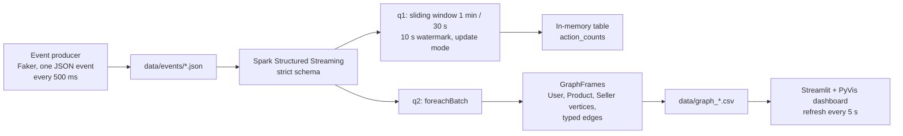

## Problem

A real-time streaming pipeline that simulates user, seller and product interactions on a marketplace, processes them
with PySpark Structured Streaming and shows them as a dynamic graph built with GraphFrames.

TODO: the question the pipeline answers, and in which course or context it was built.

## Architecture

Each event carries a timestamp, user and city, product and category, seller, action type and price. Actions follow a
weighted split: 60 % like, 30 % view, 10 % purchase.

## Technical choices & trade-offs

- **Schema enforcement** on the stream: events are read with a strict Spark schema.
- **Sliding window of 1 minute every 30 s with a 10 s watermark** on event time, in `update` output mode so only changed
  rows are emitted at each trigger.
- **`foreachBatch` to rebuild the graph**: each micro-batch updates GraphFrames vertices (users, products, sellers) and
  typed edges, exported for the dashboard.
- **File source and a simulator** instead of a message broker. TODO: why, and what a production version would use.
- TODO: the alternatives you considered and why you rejected them.

## Results

TODO: measured results (throughput, latency from event to dashboard, graph size over time).

| Metric | Value |
| ------ | ----- |
| TODO   | TODO  |

## Limitations & next steps

TODO: known limitations and next steps.

## Links

- [Source code on GitHub](https://github.com/rmouahid/pyspark-streaming-graph-platform)
