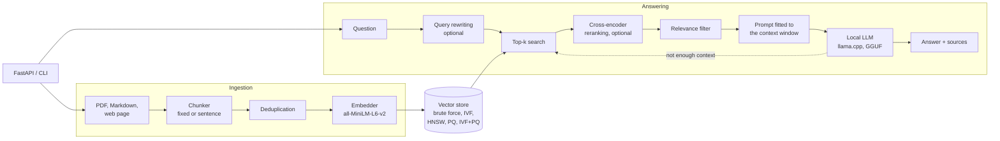
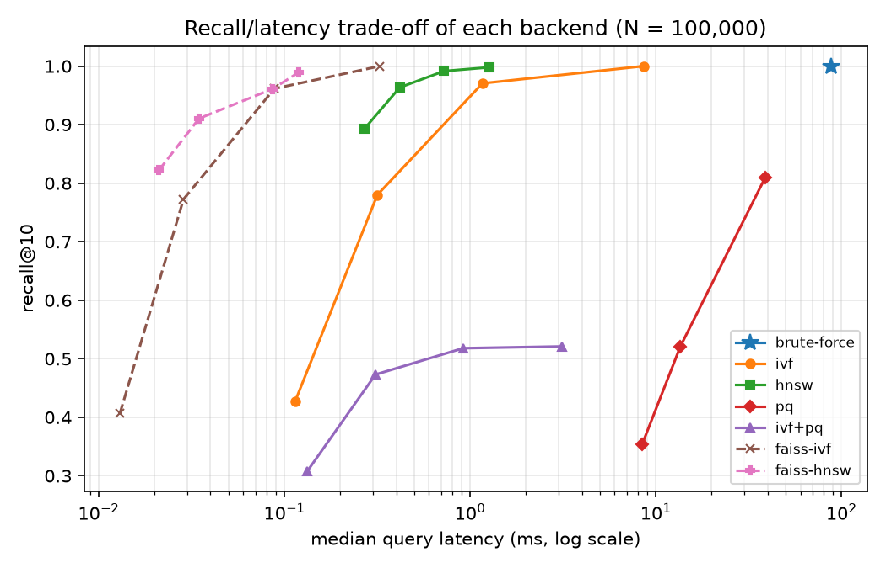

## Problem

Answer questions over your own documents on a CPU, with no inference API and no data leaving the machine, and understand
every trade-off of the retrieval layer instead of hiding it behind a framework. The vector indexes are written from
scratch and measured against brute force and FAISS on public datasets.

## Architecture

- **Vector search from scratch**: exact cosine scan, IVF with its own k-means, a multi-layer HNSW graph, product
  quantization and IVF+PQ, all in NumPy, with incremental updates.
- **Retrieval pipeline**: query rewriting, cross-encoder reranking, a relevance threshold that refuses to answer without
  supporting context, and an agentic loop that searches again when the first context is not enough.
- **Local generation**: llama.cpp with a GGUF model; the prompt is fitted to the model's context window and the answer
  cites the chunks it was given.
- **Service**: FastAPI (`/ask`, `/ask/stream`, `/documents`, `/health`) and a CLI sharing the same code.

## Technical choices & trade-offs

- **Indexes written by hand, measured against FAISS.** The point is to understand and control every trade-off (recall,
  latency, memory, build time); FAISS is the yardstick, not a dependency.
- **HNSW as the default approximate index.** On both SIFT1M and the project's own embeddings it reaches the recall of an
  exact scan at a fraction of its latency. IVF builds much faster and stays useful when the corpus changes often.
- **A local LLM through llama.cpp.** No API key, no data leaving the machine, CPU-friendly quantized weights.
- **No LangChain.** Chunking, prompt fitting, reranking and the agentic loop are short, tested modules; each step can be
  switched on or off and evaluated alone.
- **Refuse rather than guess.** Below a relevance threshold the agent says the documents do not cover the question,
  without calling the model; above it, the prompt tells the model to answer only from the passages.

## Results

All figures come from scripts in `benchmarks/`, on one CPU thread.

**Vector indexes on SIFT1M** (100,000 base vectors, 200 public queries, recall@10 against the exact top 10):

| Method                | Setting                | Recall@10 | p50 latency | p95 latency |  Memory |   Build |
| --------------------- | ---------------------- | --------: | ----------: | ----------: | ------: | ------: |
| Brute force (NumPy)   | exact scan             |     1.000 |    88.19 ms |   111.52 ms | 48.8 MB |     0 s |
| IVF (this project)    | 316 lists, `nprobe=16` |     0.971 |     1.17 ms |     5.13 ms | 49.9 MB |  21.6 s |
| HNSW (this project)   | `M=16`, `ef=32`        |     0.963 |     0.42 ms |     0.49 ms | 70.1 MB | 300.7 s |
| HNSW (this project)   | `M=16`, `ef=64`        |     0.992 |     0.72 ms |     0.85 ms | 70.1 MB | 300.7 s |
| PQ (this project)     | 64 bytes per vector    |     0.809 |    38.80 ms |    49.49 ms |  6.4 MB | 500.9 s |
| IVF+PQ (this project) | 32 bytes, `nprobe=16`  |     0.518 |     0.92 ms |     1.22 ms |  4.4 MB | 257.4 s |
| FAISS `IndexIVFFlat`  | 316 lists, `nprobe=16` |     0.962 |     0.09 ms |     0.12 ms | 49.7 MB |   1.3 s |
| FAISS `IndexHNSWFlat` | `M=16`, `ef=128`       |     0.990 |     0.12 ms |     0.15 ms | 62.6 MB |   4.0 s |

**At scale on the project's own embeddings** (384 dimensions, fastest setting reaching recall@10 ≥ 0.9):

|  Chunks | Brute force p50 | HNSW p50 | HNSW recall@10 | Speed-up |
| ------: | --------------: | -------: | -------------: | -------: |
|  10,000 |         9.40 ms |  0.43 ms |          0.937 |      22× |
| 100,000 |       418.11 ms |  0.97 ms |          0.929 |     432× |

**Retrieval quality on BEIR SciFact** (5,183 scientific abstracts, 300 expert-labelled questions):

| Configuration                                      | nDCG@10 | hit@10 | p50 latency |
| -------------------------------------------------- | ------: | -----: | ----------: |
| Chunks, exact search                               |   0.668 | 80.7 % |     39.9 ms |
| Chunks, HNSW (`ef=64`)                             |   0.668 | 80.7 % |     12.1 ms |
| Chunks, exact search + cross-encoder on the top 20 |   0.706 | 82.0 % |    953.6 ms |

**Retrieval on the project's golden dataset** (50 questions with hand-written reference passages, top 5, no LLM):

| Configuration                | Evidence recall |   MRR | Median latency |
| ---------------------------- | --------------: | ----: | -------------: |
| Exact search                 |          96.1 % | 0.833 |        < 0.1 s |
| Exact search + cross-encoder |          96.9 % | 0.950 |          0.4 s |

## Limitations & next steps

- Pure NumPy is 6 to 13 times slower per query than FAISS at the same recall, and HNSW construction is slow (5 minutes
  at 100,000 vectors, against 4 s for FAISS) because insertion runs in Python.
- Product quantization keeps memory low but loses too much recall on SIFT1M to be used alone.
- **Answer faithfulness is not published yet**: the evaluation harness (`rag-agent eval --judge`) exists, but a local
  judge needs more than one CPU.
- The relevance threshold alone refuses none of the 7 unanswerable questions of the golden dataset: they use the corpus
  vocabulary, so their passages score above it, and the refusal is left to the model.
- The store lives in process memory and on local disk: one node, no sharding, no concurrent writers.
- TODO: next steps you plan (for example publishing answer faithfulness with a stronger judge).

## Links

- [Source code on GitHub](https://github.com/rmouahid/rag-agent)
- [Benchmark reports and plots](https://github.com/rmouahid/rag-agent/tree/main/docs/benchmarks)
- [Evaluation harness and golden dataset](https://github.com/rmouahid/rag-agent/blob/main/docs/evaluation.md)
- [Architecture decision records](https://github.com/rmouahid/rag-agent/tree/main/docs/ADR)
