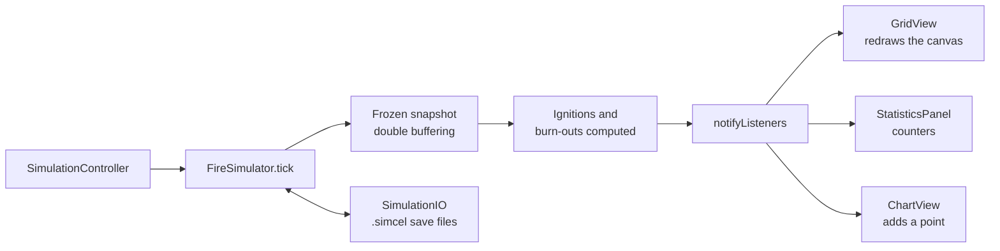

## Problem

Simulate how a wildfire spreads through a natural environment, and let the user change terrain, wind and humidity to see
their effect. Built by a team of two for the Software Engineering course at CY Tech.

TODO: your own part in the team.

## Architecture

- A 2D grid with 6 cell states (empty, healthy, burning, burnt, water, rock) and 5 terrain types, each with its own
  flammability and burn duration.
- Wind (8 directions, strength 0–5) and humidity (0–100 %).
- The probability that a neighbour ignites at each tick is
  `P = clamp(baseFlammability × windFactor × humidityFactor, [0, 1])`, with `windFactor = 1 + (strength / 5) × cos(θ)`
  and `humidityFactor = 1 − humidity / 100`. At strength 5 the probability doubles downwind and drops to zero upwind; at
  100 % humidity nothing spreads.

## Technical choices & trade-offs

- **MVC with an Observer** (`SimulationListener`): the grid view, statistics panel and chart all react to the same tick
  notification.
- **Double buffering**: every decision of a tick is based on a frozen snapshot, so the result does not depend on the
  order in which cells are visited.
- **History of the last 100 states** to step back tick by tick.
- **Two front ends on one model**: a JavaFX GUI (zoom, pan, 9 editing tools, live chart) and a headless console mode
  with ANSI rendering.
- TODO: the alternatives you considered and why you rejected them.

## Results

TODO: measured results (for example simulation speed by grid size, or spread under different wind and humidity
settings).

| Metric | Value |
| ------ | ----- |
| TODO   | TODO  |

## Limitations & next steps

TODO: known limitations and next steps.

## Links

- [Source code on GitHub](https://github.com/rmouahid/simcel)
- [UML diagrams](https://github.com/rmouahid/simcel/tree/main/docs/uml)
